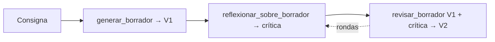

# Reflexión sobre un ensayo: borrador → crítica → revisión

Material de acompañamiento del notebook `notebook_alumno.ipynb`. Leelo antes de la
clase (secciones 1 y 2), tenelo abierto durante (3 y 4) y volvé después (5).

## Antes de empezar (quiz de 5 preguntas)

Respondé antes de leer la teoría. Las respuestas las da el profesor en clase.

1. Cuando llamás a un LLM por API, ¿qué viaja en el parámetro `messages`?
   a) Solo el último mensaje del usuario. b) La lista completa de mensajes, cada uno con su rol. c) El nombre del modelo.
2. Si mandás dos veces exactamente el mismo prompt, ¿qué pasa?
   a) Devuelve siempre el mismo texto. b) Puede devolver textos distintos. c) La segunda vez falla porque está en caché.
3. En el patrón de reflexión, ¿qué recibe como entrada el paso de **revisión**?
   a) Solo la consigna original. b) El borrador y la crítica. c) Solo la crítica.
4. ¿Por qué la crítica se pide en una llamada separada en vez de escribir "redactá y después mejorá" en un solo prompt?
   a) Porque es más barato. b) Porque el modelo tiene que recibir el borrador terminado como entrada para evaluarlo, igual que un revisor humano. c) Porque la API no acepta prompts largos.
5. Python: tenés `def f(x, model=AI_STRONG)`. ¿Qué pasa si llamás `f("hola")`?
   a) Error, falta `model`. b) `model` toma el valor de `AI_STRONG`. c) `model` queda en `None`.

## 1. Teoría breve

### Para qué sirve reflexionar

Un LLM que responde en una sola pasada comete errores que él mismo detectaría si le
mostraran el resultado terminado. Omite un contraargumento, repite una idea, cierra
sin conclusión. El patrón de **reflexión** aprovecha eso: en vez de pedir "la mejor
respuesta posible" de una, pedís un borrador, después le pedís al modelo que lo lea
con ojo crítico, y por último que lo reescriba siguiendo la crítica.

### Por qué en tres llamadas separadas

Podrías escribir un solo prompt: "escribí un ensayo, criticalo y mejoralo". Funciona
peor por tres motivos:

1. **El modelo no ve su propio texto completo antes de criticarlo.** Genera token a
   token; la "crítica" dentro del mismo turno se escribe sin haber leído el borrador
   como un todo. En una segunda llamada, el borrador entra como texto de entrada y
   el modelo lo procesa entero.
2. **Cada prompt queda simple.** Un prompt que pide tres cosas es más difícil de
   ajustar que tres prompts que piden una.
3. **Podés cambiar el modelo por paso.** Criticar suele requerir más "criterio" que
   redactar: podés usar un modelo fuerte para la crítica y uno barato para escribir.

Además, te quedan las versiones intermedias (V1, crítica, V2) para comparar y
depurar. Si la V2 salió mal, mirás la crítica y sabés si el problema fue el crítico
o el revisor.

### El flujo



Las tres funciones tienen la misma anatomía por dentro:

```python
response = client.chat.completions.create(
    model=model,
    messages=[{"role": "user", "content": instruccion}],
)
return response.choices[0].message.content
```

Lo único que cambia es **qué dice `instruccion`** y **qué datos se le inyectan**
(la consigna, el borrador, o el borrador más la crítica).

### Qué es `response.choices[0].message.content`

La API no devuelve un string: devuelve un objeto con metadatos (modelo, tokens
usados, motivo de corte) y una lista `choices`. Casi siempre hay una sola opción,
por eso `[0]`. Adentro, `message` es el mensaje del asistente y `content` su texto.
Si devolvés `response` entero en vez de `.content`, el siguiente paso recibe un
objeto en lugar de texto y el f-string lo convierte en algo como
`ChatCompletion(id=...)`. El modelo lo "critica" igual y nadie se entera.

### Sobre aisuite

`aisuite` es un cliente unificado: la misma llamada sirve para varios proveedores.
Por eso el modelo lleva prefijo: `"openai:gpt-4.1"`. En el setup definimos
`AI_CHEAP` y `AI_STRONG` con ese prefijo ya puesto, y las funciones los usan como
valor por defecto del parámetro `model`.

## 2. Ejemplo resuelto

La función `preguntar` está completa en el notebook y es el molde de todo lo demás:

```python
def preguntar(mensaje: str, model: str = AI_CHEAP) -> str:
    """Manda un único mensaje de usuario al modelo y devuelve el texto de la respuesta."""
    response = client.chat.completions.create(
        model=model,
        messages=[{"role": "user", "content": mensaje}],
    )
    return response.choices[0].message.content
```

Llamada y salida (*ejemplo ilustrativo, varía entre corridas*):

```python
>>> texto = preguntar("Explicá en una oración qué es un ensayo.")
>>> type(texto)
<class 'str'>
>>> print(texto)
Un ensayo es un texto en prosa donde el autor expone y argumenta su punto de vista sobre un tema.
```

Qué mirar: el tipo de retorno es `str` (no `ChatCompletion`), y `model` tiene un
valor por defecto que viene del entorno.

Para `generar_borrador`, el cambio es mínimo: el mensaje que se manda es la
`instruccion` ya armada (que incluye la consigna) y el default de `model` es
`AI_STRONG`. Para `revisar_borrador`, la instrucción tiene que llevar los **dos**
textos. Una forma clara:

```python
instruccion = f"""Revisá el siguiente borrador aplicando la crítica.
Devolvé únicamente el ensayo revisado.

Borrador original:
{borrador}

Crítica:
{critica}
"""
```

## 3. Práctica graduada

### Nivel base (se corresponde con los huecos del notebook)

1. **`generar_borrador(prompt, model=AI_STRONG) -> str`** (1 hueco). La instrucción
   ya está escrita. Hacé la llamada y devolvé el texto. Verificá con la celda de
   prueba que `type(borrador)` sea `str` y que tenga entre 300 y 400 palabras aprox.
2. **`reflexionar_sobre_borrador(borrador, model=AI_STRONG) -> str`** (2 huecos).
   Escribí vos la instrucción: rol de editor, qué criterios evaluar (estructura,
   claridad, argumentos, estilo), "no reescribas, solo evaluá", y el borrador
   inyectado. Después la llamada. Leé la crítica: ¿señala problemas concretos o
   elogia en general? Si elogia, endurecé el prompt.
3. **`revisar_borrador(borrador, critica, model=AI_STRONG) -> str`** (2 huecos). La
   instrucción tiene que incluir borrador **y** crítica, y pedir solo el ensayo
   revisado (sin lista de cambios). Para la llamada podés reusar `preguntar`.
4. **`reflexionar_en_bucle(prompt, rondas=2) -> dict`** (2 huecos). Generá V1,
   guardalo, y por cada ronda: criticar el **último** borrador, revisarlo, guardar
   crítica y nueva versión. Devolvé `{"borradores": [...], "criticas": [...]}`.
   Con `rondas=2` tiene que haber 3 borradores y 2 críticas.
5. Corré la celda de verificación (`run_all`). Los chequeos sin API tienen que dar
   4/4 antes de probar con la API.

### Extensión opcional (para los que terminan antes o para la casa)

No están resueltas en el notebook.

- **Crítico y escritor con modelos distintos.** Agregá a `reflexionar_en_bucle` dos
  parámetros `model_escritor` y `model_critico`. Probá `AI_CHEAP` para escribir y
  `AI_STRONG` para criticar, y al revés. Anotá en qué paso se nota más el cambio.
- **Crítica con rúbrica.** Pedile a `reflexionar_sobre_borrador` que empiece con
  cuatro puntuaciones de 1 a 5 (estructura, claridad, argumentos, estilo) y después
  la prosa. ¿La revisión responde mejor a una crítica estructurada?
- **Condición de corte.** Hacé que el crítico escriba `APROBADO` en la primera línea
  cuando no tenga objeciones de peso, y que `reflexionar_en_bucle` se detenga ahí
  aunque queden rondas.
- **Medir el largo.** Para 3 consignas, registrá palabras de V1, V2 y V3 (hay un
  helper `resumen_versiones` en `utils.py`). ¿Las revisiones alargan el texto? ¿Es
  eso una mejora o ruido?
- **Rol de sistema.** Movés el "sos un editor exigente" a un mensaje con
  `"role": "system"` en vez de ponerlo en el `user`. ¿Cambia algo? ¿Cuándo
  conviene cada forma?

## 4. Troubleshooting de más a menos frecuente

| Síntoma | Causa | Arreglo |
|---|---|---|
| `AssertionError: Falta OPENAI_API_KEY` en la celda de setup | No hay `.env` en la raíz del material, o el notebook se abrió desde otra carpeta y `find_dotenv` no lo encuentra | Copiá `.env.example` a `.env` en la raíz y completá la key. Abrí Jupyter desde la raíz del material. |
| `NotImplementedError: Completá esta función` | La celda de prueba corre antes de que completes el hueco | Es el placeholder. Completá la función y volvé a ejecutar su celda **antes** que la de prueba. |
| La celda de prueba imprime `<class 'aisuite...ChatCompletion...'>` o algo que no es `str` | Devolviste `response` en vez de `response.choices[0].message.content` | Devolvé solo el texto. El test `generar_borrador devuelve el texto del modelo` lo detecta. |
| `run_all` dice "La crítica no aparece en el prompt" | En `revisar_borrador` armaste la instrucción solo con el borrador | Inyectá `{critica}` en el f-string. Sin la crítica no hay reflexión: el modelo mejora "a ciegas". |
| `run_all` dice "La segunda crítica tiene que criticar V2, no V1" | En el bucle siempre criticás la variable del primer borrador | Usá una variable `actual` que se actualice en cada vuelta con la revisión. |
| `run_all` dice "No está usando el parámetro `model`" | Escribiste `model="openai:gpt-4.1"` adentro de la llamada | Pasá `model=model`. El nombre del modelo sale del `.env`, nunca va dentro de una función. |
| `openai.AuthenticationError` / `401` | La key es inválida o está vencida | Revisá el valor en `.env` (sin comillas, sin espacios). Reiniciá el kernel después de editar `.env`. |
| `openai.RateLimitError` / `429` | Muchos alumnos con la misma key al mismo tiempo, o sin crédito | Esperá unos segundos y reintentá. Si persiste, el profesor revisa el saldo de la cuenta. |
| La revisión viene con "Acá está la versión mejorada:" y una lista de cambios al final | El prompt no pidió "solo el ensayo" | Agregá "Devolvé únicamente el ensayo revisado, sin comentarios". Importa para encadenar rondas. |

## 5. Para cerrar

### Tres preguntas de reflexión

1. En este lab el crítico solo ve el **texto**. ¿Qué tipo de errores de un ensayo
   no puede detectar un crítico que solo lee? Pensá en datos, citas, hechos.
2. Si tuvieras que elegir **un** paso para usar el modelo más caro, ¿cuál sería y por
   qué? ¿Cambia la respuesta si la tarea fuera código en vez de un ensayo?
3. ¿Cuántas rondas de reflexión tiene sentido hacer? ¿Qué señal usarías para parar?

### Checklist de autoevaluación

- [ ] Puedo escribir de memoria la llamada `client.chat.completions.create(...)` y
      sé en qué atributo de la respuesta está el texto.
- [ ] Mis tres funciones devuelven `str` y usan el parámetro `model` (no un nombre
      hardcodeado).
- [ ] `revisar_borrador` recibe el borrador **y** la crítica, y los dos aparecen en
      el prompt.
- [ ] `reflexionar_en_bucle(prompt, rondas=2)` devuelve 3 borradores y 2 críticas,
      y cada ronda trabaja sobre la última versión.
- [ ] `run_all` da 4/4 sin API y el flujo completo corre con la API real.
- [ ] Puedo explicar con mis palabras por qué la crítica va en una llamada separada.
