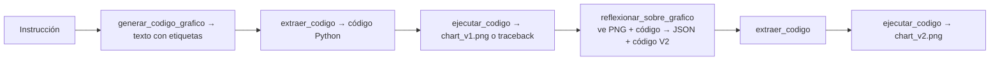

# Gráficos con reflexión multimodal: el modelo mira lo que dibujó

Material de acompañamiento del notebook `notebook_alumno.ipynb`. Leé 1 y 2 antes de
la clase; tené la sección 4 abierta mientras trabajás.

## Antes de empezar (quiz de 5 preguntas)

1. (Repaso) En el lab de SQL, ¿qué le dimos al modelo para que detectara el error de signo que no veía leyendo la consulta?
   a) Un prompt más largo. b) El resultado real de ejecutar la consulta. c) Un modelo más grande.
2. (Repaso) Si el modelo devuelve un JSON mal formado, ¿qué tiene que hacer nuestro código?
   a) Devolver un valor por defecto en silencio. b) Levantar un error con un mensaje claro. c) Reintentar infinitamente.
3. ¿Qué información tiene un modelo con visión que mira el PNG del gráfico y que **no** tiene leyendo solo el código matplotlib?
   a) Ninguna, el código determina la imagen. b) Cómo quedó realmente: etiquetas superpuestas, colores indistinguibles, barras vacías, leyenda tapando datos. c) El tamaño del archivo.
4. ¿Por qué el código generado va entre etiquetas `<execute_python>` ... `</execute_python>` en vez de pedirlo "suelto"?
   a) Porque Python lo requiere. b) Para poder separar con una regex el código de cualquier explicación que agregue el modelo, y detectar cuando no mandó código. c) Para que corra más rápido.
5. Python: `exec(codigo, {"df": df})`. ¿Qué hace el segundo argumento?
   a) Es el namespace global donde corre el código: el código ve `df` y nada más de tu notebook. b) Es una lista de módulos a importar. c) Es el archivo de salida.

## 1. Teoría breve

### Para qué: cuando el resultado es una imagen

En los labs anteriores el crítico leía texto (lab 01) o una tabla (lab 02). Acá el
modelo genera **código que produce una imagen**. Leer el código no te dice si el
gráfico quedó bien: las etiquetas del eje x se pueden pisar, dos series pueden salir
del mismo color, una barra puede quedar vacía porque un filtro no matcheó nada. Eso se
ve **mirando**. Los modelos con visión aceptan imágenes en el mensaje: le damos el
PNG y el código, y le pedimos crítica más una versión corregida.

### Por qué así: cuatro piezas separadas



Cada pieza falla de una manera distinta, y queremos que cada fallo sea **visible**:

| Pieza | Cómo puede fallar | Qué hacemos |
|---|---|---|
| `extraer_codigo` | el modelo no puso las etiquetas | `ValueError` con el principio de la respuesta |
| `ejecutar_codigo` | el código tira una excepción | devolvemos el traceback como string (es feedback) |
| `reflexionar_sobre_grafico` | no viene el JSON, o no viene el código | `ValueError` desde `extraer_json` / `extraer_codigo` |

El lab original tenía `if match:` y seguía adelante. Cuando el modelo olvidaba las
etiquetas, no se ejecutaba nada y el notebook mostraba el PNG de la corrida anterior
como si fuera el nuevo. Eso es un bug disfrazado de robustez.

### Cómo se manda una imagen por la API

El SDK de OpenAI acepta que `content` sea una **lista** de partes en vez de un string:

```python
messages=[{
    "role": "user",
    "content": [
        {"type": "text", "text": prompt},
        {"type": "image_url", "image_url": {"url": "data:image/png;base64,iVBOR..."}},
    ],
}]
```

La imagen local se codifica en base64 y se mete en una *data URL*
(`data:image/png;base64,...`). `utils.imagen_a_data_url(ruta)` lo hace. No hace falta
subir nada a ningún servidor.

### `exec` con namespace controlado

`exec(codigo, {"df": df})` ejecuta el código en un diccionario que hace de espacio
global. El código ve `df` y los módulos que él mismo importe; **no** ve las variables
de tu notebook. Las variables que cree quedan en ese diccionario. Si tira una
excepción, la capturamos con `try/except` y devolvemos `traceback.format_exc()` (el
texto completo del error) para que el flujo siga y, si queremos, se lo mostremos al
modelo.

Ejecutar código generado por un modelo es ejecutar código que no escribiste. En un
lab con un CSV local no hay riesgo; en producción esto corre en un sandbox. Lo
retomamos en M3.

### Los datos y una trampa que no está en el gráfico

El CSV tiene 3.636 ventas de una máquina de café, del 1 de marzo de 2024 al 23 de
marzo de 2025. La instrucción guía pide comparar "Q1 2024 vs Q1 2025". Pero el Q1 de
2024 **solo tiene marzo**; el de 2025 tiene tres meses. Cualquier gráfico que compare
los dos trimestres sin aclararlo va a mostrar un "crecimiento" de 4x que es un
artefacto. La pregunta que atraviesa el lab: **¿la reflexión lo detecta mirando el
gráfico?**

## 2. Ejemplo resuelto

La celda `generar_codigo_grafico` está completa. Lo que hay que mirar:

- La **descripción de columnas** viene de `utils.describir_columnas(df)`: se genera
  desde el DataFrame real. Nunca escribas a mano "las columnas son..." en un prompt
  si podés leerlas del dato.
- Los **requisitos** del código son explícitos: usar `df`, guardar en una ruta dada,
  no `plt.show()`, cerrar la figura, incluir imports. Sin eso, el código generado
  varía demasiado para ejecutarlo a ciegas.

Flujo completo (*ejemplo ilustrativo, varía entre corridas*):

```
Respuesta V1 del modelo:
<execute_python>
import matplotlib.pyplot as plt
q1 = df[df['quarter'] == 1].groupby('year')['price'].sum()
plt.figure(figsize=(6, 4))
plt.bar(q1.index.astype(str), q1.values)
plt.title('Ventas de café Q1: 2024 vs 2025')
plt.xlabel('Año'); plt.ylabel('Ingresos')
plt.savefig('data/chart_v1.png', dpi=150)
plt.close()
</execute_python>

extraer_codigo(...)  -> el bloque de adentro
ejecutar_codigo(...) -> None   (se creó data/chart_v1.png)

Crítica (mirando el PNG):
{"feedback": "El gráfico muestra dos barras sin etiquetas de valor ni unidad en el eje y.
 No se distingue si compara cantidad de ventas o ingresos. Faltan colores diferenciados
 y una nota sobre el período cubierto."}

Código V2: barras con valores encima, eje y con unidad, título más preciso.
ejecutar_codigo(V2) -> None   (se creó data/chart_v2.png)
```

Fijate que la crítica típica es de **forma**. Casi nunca dice "2024 tiene un solo mes
de datos", porque eso no se ve en el gráfico ni en el código.

## 3. Práctica graduada

### Nivel base (se corresponde con los huecos del notebook)

1. **`extraer_codigo(texto) -> str`** (1 hueco). `re.search` con el patrón de las
   etiquetas; si no hay match, `ValueError` en español con los primeros 150
   caracteres de la respuesta. Si el bloque está vacío, también `ValueError`.
   Probalo con la celda de prueba: un caso con etiquetas y uno sin.
2. **`ejecutar_codigo(codigo, df) -> str | None`** (1 hueco). `exec` dentro de un
   `try`; devolvé `None` si anduvo o `traceback.format_exc()` si no. Probalo con el
   snippet roto de la celda de prueba: tiene que devolver un string con `KeyError`,
   no romper el notebook.
3. **`reflexionar_sobre_grafico(...) -> tuple[dict, str]`** (3 huecos). Codificá la
   imagen con `utils.imagen_a_data_url`, armá el `content` como lista con las dos
   partes, llamá al modelo fuerte, y parseá: `utils.extraer_json(contenido)` para el
   feedback (validá que tenga la clave `"feedback"`) y tu `extraer_codigo` para la V2.
4. **`correr_workflow(...)`** (2 huecos). Encadená generar → extraer → ejecutar;
   si V1 falló, cortá y devolvé lo que tenés; si no, reflexioná → ejecutar V2. Guardá
   todo en el dict `resultado`.
5. Corré el workflow con la instrucción de bebidas por franja horaria y mirá las dos
   imágenes. Anotá qué cambió entre V1 y V2 y si el cambio responde a la crítica.

### Extensión opcional (para los que terminan antes o para la casa)

- **Darle los datos al crítico.** Agregá al prompt de `reflexionar_sobre_grafico` la
  tabla `conteo` (`.to_markdown(index=False)`). ¿Ahora detecta que el Q1 de 2024 está
  incompleto? ¿Qué hace la V2: lo aclara en el título, compara solo marzo, lo ignora?
- **Reflexión sobre el error.** Cuando `ejecutar_codigo` devuelve un traceback, en
  vez de cortar mandáselo al modelo (sin imagen) y pedile el código corregido. Vas a
  necesitar que `reflexionar_sobre_grafico` acepte `ruta_png=None` y arme el
  `content` sin la parte de imagen.
- **Dos rondas.** Reflexioná sobre `chart_v2.png` y generá una V3. Mostrá las tres
  imágenes. ¿Mejora o solo cambia?
- **Rúbrica visual.** Pedí al crítico, además del feedback, tres puntuaciones de 1 a
  5: legibilidad, fidelidad a la instrucción, honestidad con los datos.
- **Modelo barato para criticar.** `gpt-4.1-mini` también ve imágenes. Corré con
  `model_reflexion=MODEL_CHEAP` y compará la crítica.

## 4. Troubleshooting de más a menos frecuente

| Síntoma | Causa | Arreglo |
|---|---|---|
| `ValueError: La respuesta del modelo no tiene las etiquetas <execute_python>` | El modelo contestó con ```python o con prosa | Es tu validación funcionando. Reforzá el prompt ("sin backticks, sin explicaciones fuera de las etiquetas") o reintentá: con `temperature=0` suele ser estable. |
| `ejecutar_codigo` devuelve un traceback con `KeyError: 'quarter'` o similar | El código usa una columna que no existe; o el `df` que le pasaste no es el de `cargar_datos` | Verificá que `df` tenga `year`, `quarter`, `month` (los agrega `cargar_datos`). Si el modelo inventó una columna, mirá la descripción que le mandaste. |
| `FileNotFoundError: No existe data/chart_v1.png` al reflexionar | El código V1 falló o guardó en otra ruta | Mirá `error_v1`. Si es `None`, buscá en el código V1 la línea `savefig`: ¿usa la ruta que le pediste? |
| `openai.BadRequestError: Invalid image` o `400` | La data URL está mal armada (falta el prefijo `data:image/png;base64,`) o el archivo no es PNG | Usá `utils.imagen_a_data_url`, no armes el string a mano. |
| `openai.BadRequestError: ... content ... string` | Mandaste `content` como string en vez de lista | Para imágenes, `content` tiene que ser una **lista** de partes `{"type": ..., ...}`. |
| El gráfico V2 es idéntico al V1 | El código V2 guardó en `chart_v1.png` (el modelo copió la ruta vieja), o el modelo devolvió el mismo código | Chequeá la línea `savefig` en `codigo_v2`. Pasale `ruta_salida_v2` explícita en el prompt (ya está). Compará `codigo_v1 == codigo_v2`. |
| `ValueError: No pude extraer un objeto JSON...` en la reflexión | El modelo puso el código antes del JSON, o no mandó JSON | `extraer_json` busca antes de `<execute_python>`. Reforzá "primera línea: JSON". |
| Aparece una ventana o `UserWarning: Matplotlib is currently using agg` | `plt.show()` en el código generado | El prompt lo prohíbe; si aparece, agregá a los requisitos "nunca plt.show()". El backend `Agg` del setup evita la ventana. |
| Las imágenes que se muestran son de la corrida anterior | No se borraron los PNG viejos | La celda de setup llama a `utils.borrar_pngs("data")`. Volvé a correrla si cambiaste de instrucción sin cambiar `nombre_base`. |

## 5. Para cerrar

### Tres preguntas de reflexión

1. El crítico vio el gráfico y el código pero no los datos. ¿Qué otras cosas podrías
   darle como contexto para que critique **fondo** y no solo **forma**? ¿Cuál es el
   costo de darle todo?
2. En este lab, si el código V1 falla, cortamos. ¿Qué pasaría si en vez de cortar le
   damos el traceback al modelo? ¿Cuántas veces reintentarías? ¿Qué podría salir mal
   con un bucle de reintentos sin tope?
3. Los tres labs del módulo usan el mismo patrón con tres tipos de feedback (texto,
   tabla, imagen). ¿En cuál de los tres te parece que la reflexión aporta más? ¿Por qué?

### Checklist de autoevaluación

- [ ] `extraer_codigo` levanta `ValueError` con mensaje en español cuando no hay
      etiquetas; no devuelve `None` ni string vacío.
- [ ] `ejecutar_codigo` devuelve `None` o el traceback como string; nunca rompe el
      notebook.
- [ ] Puedo escribir de memoria la estructura de un mensaje multimodal (`content` como
      lista con `text` e `image_url`).
- [ ] Sé qué es una data URL y por qué sirve para mandar una imagen local.
- [ ] `correr_workflow` corta limpio si V1 falla y devuelve el dict con lo que tiene.
- [ ] Puedo explicar por qué la reflexión no detectó (o sí) que el Q1 2024 tiene un
      solo mes, y qué habría que darle para que lo detecte.
